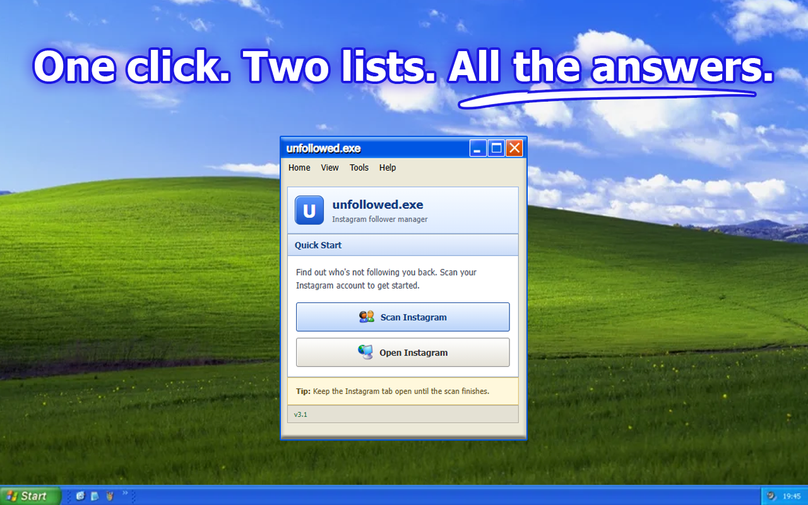

 

# unfollowed.exe

**An Instagram follower comparison extension with a Windows XP-inspired interface.**

Scan your followers and following lists, find accounts that don't follow you back, and explore your connections in a retro desktop-style interface.

## Features

- **One-click full scan** — automatically scans Following and then Followers from your Instagram profile.
- **Non-followback results** — find accounts you follow that don't follow you back.
- **Multiple views** — browse Followers, Following, Mutuals, Fans, and Not Following Back.
- **Search and sorting** — search usernames and sort alphabetically.
- **Selective refresh** — update Followers or Following independently.
- **Export and backups** — export CSV results, back up data to JSON, and restore it later.
- **Ignore list** — exclude chosen accounts from comparison results.
- **Scan progress and cancellation** — monitor scanning and stop without replacing previously saved lists.
- **Retro UI** — Windows XP-inspired popup and side panel.

## Installation

**The easiest way to install unfollowed.exe is through the Chrome Web Store.**

1. Visit the [unfollowed.exe Chrome Web Store page](https://chromewebstore.google.com/detail/unfollow3d/kdkgfkbcjjfohpedofakfeldkoejinpp).
2. Click **Add to Chrome**.
3. Confirm the installation.
4. Open Instagram and sign in to your account.
5. Open the extension and enter your Instagram username.

You're ready to scan!

> The extension uses your existing Instagram browser session. You do not need to provide your Instagram password to the extension.

## How to use

1. Open your Instagram profile and select **Scan Instagram**.
2. Keep the Instagram tab open while the extension collects your Following and Followers lists.
3. Open **View** to explore your results.
4. Use the filters to browse non-followbacks, mutuals, fans, followers, and following.
5. Use **Tools** to refresh saved lists, manage ignored accounts, or back up your data.
6. Select **Download CSV** to export your non-followback results.

## How it works

unfollowed.exe is built using Chrome Extension Manifest V3.

- `popup.html`, `popup.js`, `style.css` — extension interface and results.
- `content.js` — collects usernames from Instagram's list dialogs.
- `background.js` — manages scanning, progress, and saved results.
- `manifest.json` — extension configuration.

Saved data is stored locally using `chrome.storage.local`.

## Privacy

unfollowed.exe does not ask for your Instagram password.

Your saved username lists, ignored accounts, and scan history are stored in Chrome's local extension storage. You can clear saved data through the extension's Tools tab.

CSV and JSON files are exported only when requested.

## Limitations

- Not affiliated with Instagram or Meta.
- Instagram may change its interface or temporarily restrict list loading.
- Follower counts may occasionally differ from the number of accounts loaded.
- Scans may take longer for larger accounts.
- Results reflect collected lists and may be incomplete or outdated.
- The extension cannot determine exactly when someone unfollowed you without an earlier snapshot.

## Installation for developers

To run the extension locally:

1. Clone or download this repository.
2. Open `chrome://extensions` in Google Chrome.
3. Enable **Developer mode**.
4. Select **Load unpacked**.
5. Choose the extension directory containing `manifest.json`.
6. Open Instagram and launch the extension.

No build step is required for the core extension.

## Disclaimer

unfollowed.exe is an independent project and is not affiliated with, endorsed by, or sponsored by Instagram or Meta.

---

**Made with JavaScript, Chrome Extensions API, and Windows XP nostalgia.**

